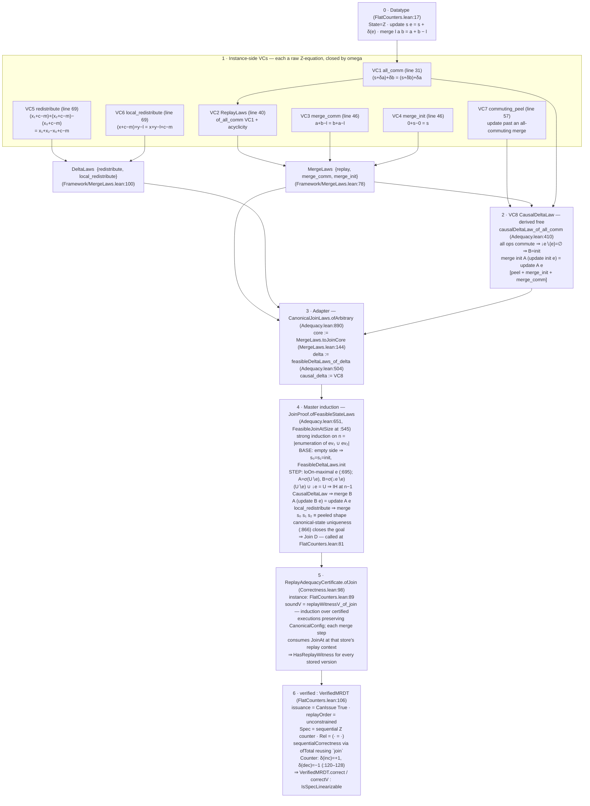

# How the PN counter's VCs are discharged

Companion to `mrdt-join-vs-vc-routes.md`. The PN counter
(`Sal/MRDTs/Instances/FlatCounters.lean`) is the canonical example of the VC
route: every datatype-specific obligation is a raw integer equation closed by
`omega`, and all contextual/inductive work is done once, generically, by the
framework.

The datatype (`FlatCounters.lean:17`):

```lean
State  := Int
init   := 0
update s e := s + delta e          -- delta e = ±1 for inc/dec
merge  l a b := a + b - l          -- addition with GCA subtraction
query  s _ := s
```

## Mermaid flowchart



## Stage-by-stage notes

### Stage 1 — the eight VCs, seven of them `omega`

| # | Obligation | Statement (unfolded to ℤ) | Where | Tactic |
|---|---|---|---|---|
| 1 | `all_comm` | `(s + δa) + δb = (s + δb) + δa` | `FlatCounters.lean:31` | `omega` |
| 2 | `ReplayLaws` | derived: `ReplayLaws.of_all_comm` + no replay-order chain (`OrderResult.noConfusion`) | `:40` | derived |
| 3 | `merge_comm` | `a + b − l = b + a − l` | `:46` | `omega` |
| 4 | `merge_init` | `0 + s − 0 = s` | `:46` | `omega` |
| 5 | `redistribute` | `(x₁+c−m) + (x₂+c−m) − (x₀+c−m) = x₁+x₂−x₀ + c − m` | `:69` | `omega` |
| 6 | `local_redistribute` | `(x+c−m) + y − l = x + y − l + c − m` | `:69` | `omega` |
| 7 | `commuting_peel` | `update` slides past a merge of all-commuting prefixes (after unfolding `applySeq` folds) | `:57` | `omega` |
| 8 | `CausalDeltaLaw` | **not hand-proved** — see stage 2 | — | derived |

VC3+VC4 package as `MergeLaws` (`Framework/MergeLaws.lean:78`); VC5+VC6
package as `DeltaLaws` (`Framework/MergeLaws.lean:100`). Note what is *absent*:
no `merge_idem` and no lattice laws — the delta contract deliberately replaces
them (`redistribute` is the ternary stand-in for idempotence: the GCA-slot copy
cancels the duplicated delta).

### Stage 2 — the counter gets `CausalDeltaLaw` for free

`causalDeltaLaw_of_all_comm` (`Metatheory/Adequacy.lean:410`) consumes only
`MergeLaws`, `CommutingPeelLaw`, and `all_comm`:

1. every pair of operations commutes, so the strict downset minus the event
   itself is empty: `↓e ∖ {e} = ∅`, hence the canonical `B` equals `init`;
2. `commuting_peel` at an empty GCA fold plus `merge_init` and `merge_comm`
   yields `merge init A (update init e) = update A e` — exactly the causal-delta
   equation at the honest GCA.

This is why commuting datatypes are the cheap case of the VC route.

### Stage 3 — arbitrary-state → canonical-state adapter

`CanonicalJoinLaws.ofArbitrary` (`Adequacy.lean:890`) retracts the strong
arbitrary-state equations to the canonical-state contract:

- `core := MergeLaws.toJoinCore` (`MergeLaws.lean:144`),
- `delta := feasibleDeltaLaws_of_delta` (`Adequacy.lean:504`) — restricts VC5/VC6
  to canonically-reachable states,
- `causal_delta :=` the derived VC8.

### Stage 4 — the one-time master induction

`JoinProof.ofFeasibleStateLaws` (`Adequacy.lean:651`) proves
`FeasibleJoinAtSize C n` by strong induction on `n`, the length of any
permutation enumerating `ev₁ ∪ ev₂`:

- **Base — an empty side.** If `ev₁ = ∅`, canonicity forces
  `s₀ = s₁ = init`; `FeasibleDeltaLaws.init` collapses the merge to the other
  side's canonical state (mirrored for `ev₂ = ∅`).
- **Step.** Pick a `loOn(ev₁∪ev₂)`-maximal event `e` (`:695`), set
  `A = σ(U∖e)` and `B = σ(↓e∖e)`:
  1. `(U∖e) ∪ ↓e = U`, so the induction hypothesis at length `n−1` makes
     `merge B A (update B e)` canonical for `U`;
  2. `CausalDeltaLaw` rewrites it to `update A e`;
  3. the feasible `local_redistribute` pulls the outer merge
     `merge s₀ s₁ s₂` into the peeled shape;
  4. `isCanonicalState_unique_of_replayLaws` (`:866`) closes the goal, since
     canonical states of one event set (under `ReplayLaws`) are unique.

The instance's `join` (`FlatCounters.lean:81`) is exactly
`JoinProof.ofArbitraryStateLaws mergeLaws deltaLaws VC8` — stages 2–4 with no
counter-specific input.

### Stage 5 — from `Join` to replay adequacy

`ReplayAdequacyCertificate.ofJoin` (`Metatheory/Correctness.lean:98`), applied
at `FlatCounters.lean:89`. Its `soundV` is `replayWitnessV_of_join`: an
induction over widened certified executions (`MintCertifiedReachV`) that
preserves the `CanonicalConfig` invariant; each merge transition consumes
`JoinAt` at that store's own replay context. Result: `HasReplayWitness` — every
stored version's state is the fold of some linearization respecting `loOn`.

### Stage 6 — the public package

`verified : VerifiedMRDT` (`FlatCounters.lean:106`) assembles:

- `issuance` = `CanIssue := True` (free signed deltas — decrements below zero
  are legal, checked by `counter_controls` at `:131`),
- `replayOrder` = `EventOrder.unconstrained`,
- `replayAdequacy` from stage 5,
- `Spec` = the sequential `Int` counter, `Rel = (· = ·)`,
- `sequentialCorrectness` via `SequentialCorrectnessCertificate.ofTotal`,
  which re-uses `join delta C.replayContext` — the same `Join` theorem feeds
  both convergence and sequential correctness.

The `Counter` specialization (`:120–128`: `inc ↦ +1`, `dec ↦ −1`) yields
`counterVerified : VerifiedMRDT Counter`, and `VerifiedMRDT.correct` /
`.correctV` are the client-facing `IsSpecLinearizable` theorems.
